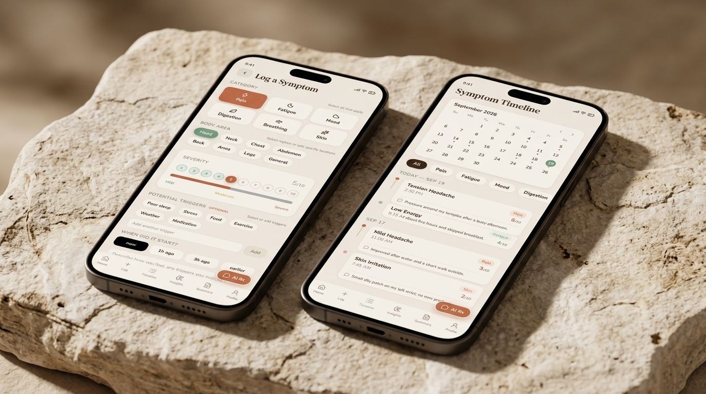
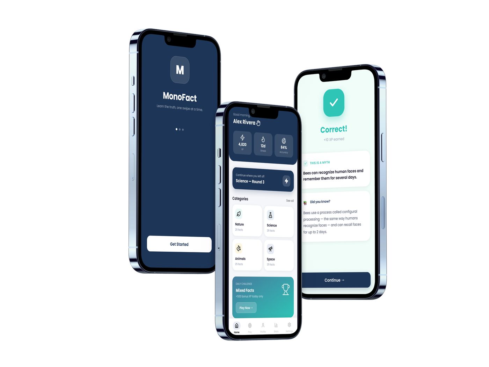
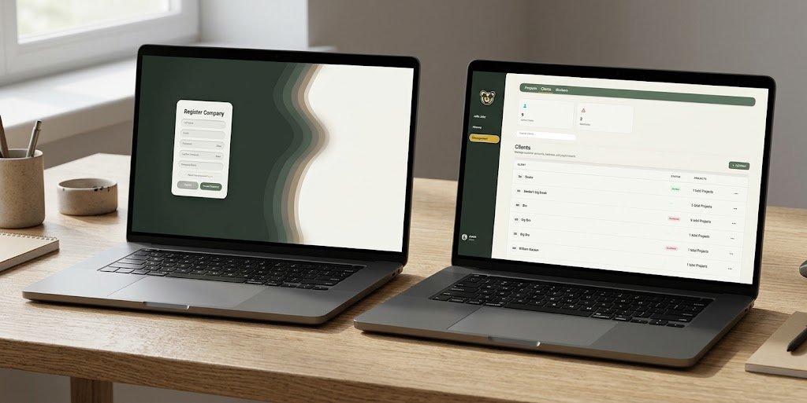
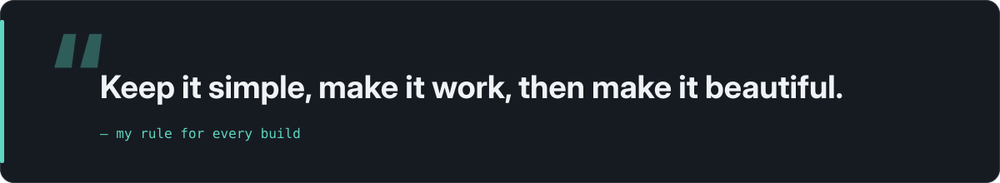

<!-- 1. HEADER & PROFILE IMAGE -->

  

<!-- 2. SHORT BIOGRAPHY -->
## About Me

<!--  -->

I'm a final-year **Bachelor of Creative Technologies** student specialising in **Interactive Development** at The Open Window Institute in Pretoria.

I design digital experiences and build the applications behind them, from interface and prototype through to working web, mobile and desktop software.

🏆 **Encore 2026 Intervarsity Portfolio Day:** Overall Portfolio Winner and 1st Place in Digital Communication Design.

 

<!-- 3. SKILLS (CAREER FOCUS) -->
## Career Focus

I'm aiming for a **graduate or junior developer role** where design and development meet.

<table>
  <tr>
    <td width="25%" align="center" valign="top">
       
      <b>Interface &amp; UX design</b> 
      Figma prototypes and design systems, built to ship.
    </td>
    <td width="25%" align="center" valign="top">
       
      <b>Mobile apps</b> 
      Cross-platform React Native and Expo apps.
    </td>
    <td width="25%" align="center" valign="top">
       
      <b>Full-stack web &amp; APIs</b> 
      React on FastAPI, Flask or ASP.NET Core.
    </td>
    <td width="25%" align="center" valign="top">
       
      <b>Secure AI features</b> 
      LLM calls kept server-side, never in the client.
    </td>
  </tr>
</table>

  <b>CURRENTLY LEARNING</b> 
  
  
  

<!-- 4. TECH STACK BADGES -->
## Tech Stack

<table>
  <tr>
    <td><b>Languages</b></td>
    <td>
      
      
      
      
      
      
    </td>
  </tr>
  <tr>
    <td><b>Frontend &amp; Mobile</b></td>
    <td>
      
      
      
      
      
    </td>
  </tr>
  <tr>
    <td><b>Backend</b></td>
    <td>
      
      
      
    </td>
  </tr>
  <tr>
    <td><b>Data &amp; Cloud</b></td>
    <td>
      
      
      
      
    </td>
  </tr>
  <tr>
    <td><b>AI &amp; Testing</b></td>
    <td>
      
      
      
      
    </td>
  </tr>
  <tr>
    <td><b>Design &amp; Tools</b></td>
    <td>
      
      
      
      
      
      
    </td>
  </tr>
</table>

<!-- 5. PORTFOLIO PROJECT REPOSITORIES -->
## Portfolio Projects

### DV300 Main Projects

My three major projects for **Interactive Development 300 (2026)**. Each repository holds the full process documentation.

<table>
  <tr>
    <td width="50%">
      
    </td>
    <td width="50%" valign="middle">
      <b>01 · DV300 SEMESTER 2 · MOBILE APP</b>
      <h3>SymptomJournal</h3>
      
A mobile health companion that replaces the anxiety of Googling symptoms with structured self-tracking: log symptoms, spot patterns over time with AI, and export a clear summary for your next doctor's appointment.

      

        
        
        
        
        
        
      

      
      
      
    </td>
  </tr>
  <tr>
    <td width="50%" valign="middle">
      <b>02 · DV300 SEMESTER 2 · MOBILE APP</b>
      <h3>MonoFact</h3>
      
A swipe-to-judge "fact or myth" quiz across six knowledge decks. The improvements branch grows each deck to 100 facts (600 in total) and adds a card-count picker (10, 25, 50, 100 or the full deck), so a round can be a quick warm-up or a longer session.

      <ul>
        <li><b>Daily reminder</b> at 19:00, switchable in Settings.</li>
        <li><b>Secure data model:</b> Firestore rules let each user read and write only their own document. Fact decks are read-only to clients and seeded server-side with the Admin SDK.</li>
        <li><b>Gamification:</b> XP and streak bonuses, levels, 27 achievements and daily challenges.</li>
        <li><b>Tested:</b> Jest suites for the shuffle, date and stats logic.</li>
      </ul>
      

        
        
        
        
        
      

      
      
      
    </td>
    <td width="50%">
      
    </td>
  </tr>
  <tr>
    <td width="50%">
      
    </td>
    <td width="50%" valign="middle">
      <b>03 · DV300 SEMESTER 1 · DESKTOP APP · TEAM OF 4</b>
      <h3>Projello</h3>
      
Lightweight project management for construction crews: a 30-second daily check-in instead of Jira-style cards, milestone tracking, photo-verified progress, a client portal and one-click calls for on-site issues.

      
<b>My role:</b> the Electron/React client's integration with the ASP.NET Core API, plus a security hardening pass on my fork.

      
<b>Security hardening</b> (<code>security-hardening</code> branch):

      <ul>
        <li><b>Secrets:</b> the committed JWT secret is removed. Keys come from the environment, and the API refuses to start if one is missing.</li>
        <li><b>Brute-force protection:</b> accounts lock for 15 minutes after 5 failed sign-ins, and auth endpoints are rate-limited.</li>
        <li><b>Access control:</b> 2FA endpoints use the caller's identity, client endpoints are limited to company staff, and the call hub requires sign-in.</li>
        <li><b>Deployment:</b> the API runs in Docker Compose with migrations applied on startup.</li>
      </ul>
      

        
        
        
        
        
        
      

      
      
    </td>
  </tr>
</table>

### Other Projects

| Project | About | Built with |
|:---|:---|:---|
| [**CV Reviewer**](https://github.com/FrancoisleRouxDev/CV-reviewer) · [Live demo](https://client-two-rouge-55.vercel.app) | Upload a PDF CV and get a score, strengths, weaknesses and missing keywords from the Gemini API | React · Flask · SQLite |
| [**Budget Tracker CLI**](https://github.com/FrancoisleRouxDev/Budget-Tracker-cli) | Terminal income and expense tracker with a category breakdown chart | Python · SQLite · Rich |

<!-- 6. GITHUB REPOSITORY STATISTICS -->
## GitHub Stats

  

  
  

<!-- 6b. QUOTE -->
## Philosophy

  

---

<!-- 7. CONTACT INFORMATION -->
## Contact

Open to graduate and junior developer roles. Email is the quickest way to reach me.

  
   
  
  

  
    Resources consulted: <a href="https://github.com/braydoncoyer/braydoncoyer">Braydon Coyer's GitHub profile</a> ·
    <a href="https://github.com/abhisheknaiidu/awesome-github-profile-readme">Awesome GitHub Profile list</a> (CC0) ·
    Repository template by Armand Pretorius
  

  

