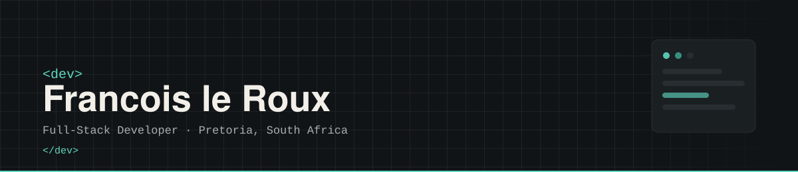

<p align="center">
  
</p>

<h1 align="center">Francois le Roux</h1>

<p align="center">Full-Stack Developer · Pretoria, South Africa</p>

<p align="center">Building web, mobile, and desktop applications across the full development lifecycle.</p>

---

## About Me

```javascript
const francois = {
  education: "Bachelor of Creative Technologies — Interactive Development, The Open Window Institute (2026)",
  location: "Pretoria, South Africa",

  stack: [
    "React / React Native",
    "C# / .NET",
    "Python / Flask / FastAPI",
    "PostgreSQL / SQLite / Supabase"
  ],

  currentlyLearning: [
    "MongoDB (Associate Developer Certification)",
    "Blazor / .NET MAUI"
  ],

  currentGoal:
    "Build strong software development skills, grow my portfolio, and secure a graduate or junior developer role.",

  interests: [
    "Full-Stack Web Applications",
    "Mobile Development",
    "User Experience Design",
    "Problem Solving"
  ]
};
```

---

## Technical Skills

**Frontend**
HTML5 · CSS3 · JavaScript · TypeScript · React · React Native

**Backend**
C# · .NET · Python · Flask · FastAPI

**Databases**
PostgreSQL · SQLite · Supabase · MongoDB

**Design**
Figma · UI/UX Design · Prototyping · Responsive Design

**Tools & Platforms**
Git · GitHub · Vercel · Render · Expo · Electron · Docker · VS Code · Figma

---

## Projects

### SymptomJournal
A mobile health companion that replaces the anxiety of Googling symptoms with structured self-tracking — log symptoms, spot patterns over time, and generate a clear summary to bring to a doctor's appointment. AI analysis runs through the backend rather than calling the model straight from the app.

**Stack:** React Native (Expo) · FastAPI · Supabase (PostgreSQL) · Google Gemini / NVIDIA NIM · Render

> Currently in final development phases.

🔗 Repository: [SymptomJournal](https://github.com/FrancoisleRouxDev/SymptomJournal)

---

### CV Reviewer
A full-stack AI-powered CV reviewer for students and junior developers. Users register, log in, and upload a PDF CV to receive structured feedback — a score, strengths, weaknesses, missing keywords, and actionable suggestions generated via the Google Gemini API. Features JWT authentication (bcrypt-hashed passwords) and five user-selectable themes that persist between sessions.

**Stack:** React (Vite) · Python · Flask · Google Gemini API · SQLite · Vercel

🔗 Live Demo: [client-two-rouge-55.vercel.app](https://client-two-rouge-55.vercel.app)
🔗 Repository: [CV-Reviewer](https://github.com/FrancoisleRouxDev/CV-reviewer)

---

### MonoFact
A swipe-to-judge "fact or myth" quiz game across six knowledge decks — Nature, Science, Animals, Space, Photography and Technology. Built a full gamification layer: XP and streak bonuses, an exponential level curve, 27 achievements and daily challenges, backed by Firebase.

**Stack:** React Native · Expo · TypeScript · Firebase (Firestore + Auth)

🔗 Repository: [MonoFact](https://github.com/FrancoisleRouxDev/MonoFact)

---

### Projello
*Team project — 4 developers.* A lightweight project management system built for construction site crews, who need a 30-second daily check-in rather than Jira-style cards and story points — milestone tracking, photo-verified progress updates, a read-only client portal, and one-click voice/video calls for on-site issues. I worked on the integration between the Electron/React client and the ASP.NET Core API.

**Stack:** React · TypeScript · Electron · ASP.NET Core (C#) · PostgreSQL (EF Core) · SignalR

🔗 Repository: [Projello](https://github.com/AngievR05/Projello-Management-System)

---

### Budget Tracker CLI
A command-line income and expense tracker — add transactions, view totals and balance, and generate a category breakdown chart, all from the terminal. Kept deliberately small and modular, using Rich for readable tables instead of a GUI.

**Stack:** Python · SQLite · Rich · Matplotlib

🔗 Repository: [Budget-Tracker-cli](https://github.com/FrancoisleRouxDev/Budget-Tracker-cli)

---

## GitHub Stats

<p align="center">
  
  
</p>

---

## Contributions & Streak

<p align="center">
  
</p>

---

## Connect

<p align="center">
  <a href="https://francoislerouxdev.github.io/" target="_blank">
    
  </a>
  <a href="https://www.linkedin.com/in/francois-le-roux-2415182a5/" target="_blank">
    
  </a>
  <a href="mailto:francoislerouxdev@gmail.com" target="_blank">
    
  </a>
</p>
